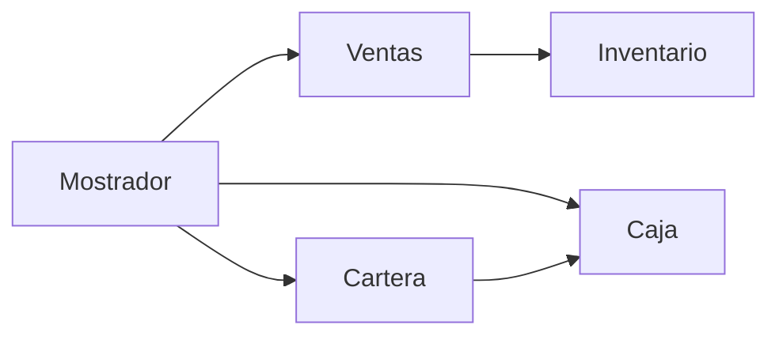

# Arquitectura

Mostrador guarda el ciclo en memoria y lo prueban los tests. No hay interfaz ni base de datos en este corte. EC2 espera a que el ciclo esté en `main`.

`src/domain` no importa ventas, cartera ni caja. La parte A agrega la recepción de compra sobre `Inventario.reponer` y `actualizarCostoPromedio`, sin reescribir el stock de las ventas.
