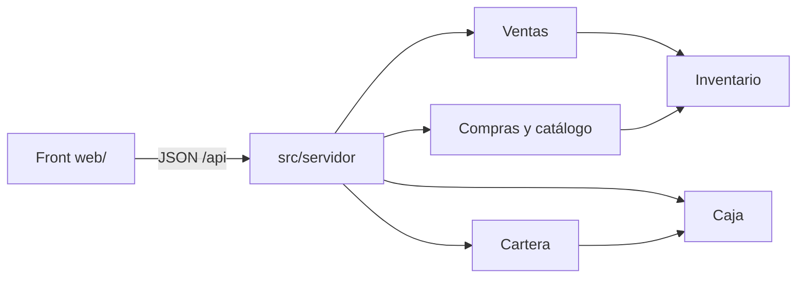

# Arquitectura

Mostrador guarda el ciclo en memoria. El dominio no hace I/O; un servidor HTTP de Node lo envuelve y sirve el front. No hay base de datos en este corte: al reiniciar el servidor, el estado vuelve a los datos de ejemplo. La instancia EC2 ya está descrita en `docs/infra/EC2.md`.

`src/domain` no importa ventas, cartera ni caja. La parte A agrega la recepción de compra sobre `Inventario.reponer` y `actualizarCostoPromedio`, sin reescribir el stock de las ventas.

## Servidor

`src/servidor/app.ts` traduce HTTP a llamadas del dominio y no tiene reglas propias: valida solo la forma de la entrada (texto, entero, lista) y deja cada regla al dominio. Una `ReglaNegocio` sale como `422` con `{ error: { codigo, mensaje } }`; el front muestra el mensaje tal cual.

| Ruta | Qué hace |
| --- | --- |
| `GET /api/resumen?fecha=` | Caja del día, por cobrar, vencidas, stock bajo |
| `GET/POST /api/productos` | Catálogo y alta |
| `GET /api/productos/:id/kardex` | Movimientos de un producto |
| `GET/POST /api/compras`, `POST /api/compras/:id/recibir` | Compra en borrador y recepción |
| `GET/POST /api/ventas`, `POST /api/ventas/:id/anular` | Contado, crédito y anulación |
| `GET /api/cuentas`, `GET /api/cobranza?fecha=` | Cartera y cobranza vencida |
| `GET/POST /api/abonos` | Abonos |
| `GET /api/caja?fecha=`, `POST /api/cierres` | Caja del día y cierre |

El servidor genera los ids (`ven-N`, `com-N`, `abo-N`, `cie-<fecha>`) y el instante con su reloj. Los montos viajan en centavos enteros.

`npm start` lo levanta. `PORT` elige el puerto (3000 por defecto) y `MOSTRADOR_SEMILLA=0` arranca sin datos de ejemplo. Son las dos variables que hará falta fijar en EC2.

## Front

`web/` es HTML, CSS y módulos JS sin dependencias ni compilación. `app.mjs` enruta por hash (`#/ventas`, `#/caja?fecha=…`) y pinta cada vista; `api.mjs` habla con el servidor; `formato.mjs` muestra y lee soles sin pasar por decimales.

- Superficie de trabajo: clara, un acento verde para acciones y estado, tablas densas y legibles.
- Responsivo: barra lateral en escritorio, pestañas arriba bajo 56rem; columnas secundarias (`.opcional`) se ocultan bajo 40rem.
- Movimiento mínimo: escala al pulsar un botón y la entrada del aviso. Con `prefers-reduced-motion` solo queda la opacidad.
- La CSP del servidor no admite estilos ni scripts en línea: todo estilo va en `estilos.css`.
