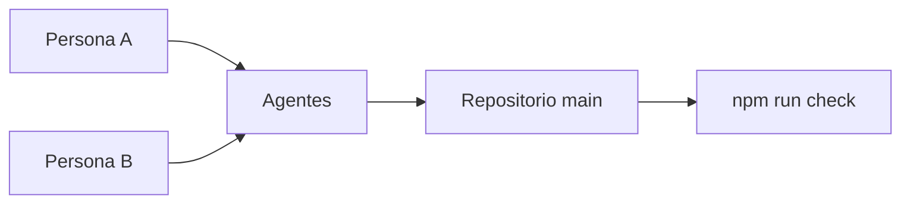

# Arquitectura

Todavía no hay aplicación. Este documento se llena en el mismo cambio que define el producto en [product/ALCANCE.md](product/ALCANCE.md).

Hasta entonces el sistema es el arnés:

Cada persona habla con su agente. Los agentes leen el mismo repositorio. `npm run check` es la puerta antes del pull request.
